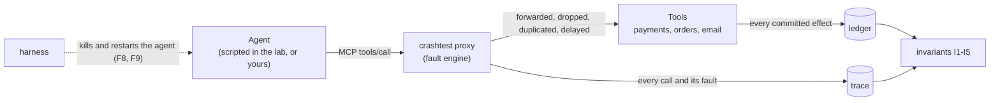

# agent-crashtest

**Chaos testing for AI agents.** agent-crashtest sits between an agent and its tools and makes them fail the way real tools fail: a payment that goes through but never answers, a request delivered twice, a process killed mid-step, a reply cut in half, a slow tool, a 429. Then it checks what really happened, from a ledger of committed effects rather than the agent's own account. Was anyone charged twice? Did any work get lost? Did the retries stop?

[](https://github.com/trailofblocks/agent-crashtest/actions/workflows/ci.yml)
[](LICENSE)

> **Status: v0.1.** The agents in the lab are scripted; no model has been run against agent-crashtest. Read [What has and hasn't been verified](#what-has-and-hasnt-been-verified).

An agent calls `create_charge` and gets a timeout. Maybe the charge went through and the reply was lost, or maybe the request never arrived. From the agent's side, the two look identical. If it retries, a lost reply becomes a double charge. If it doesn't, a lost request becomes a missed payment, reported as a failure. The fixes are old: idempotency keys, an outbox, and dedup at the receiver. They're also easy to get almost right. agent-crashtest checks whether an agent got them right:

```text
F1 Lost response, framework retry policy (checkout, fault on call 2):
  I1 Exactly once: charge for cart_7781 committed 2 times ($58.00 + $58.00)
```

## How it works



- **Where the faults go in.** Faults are injected at the MCP JSON-RPC boundary by a message-level proxy. Every message passes through unchanged except `tools/call`, so both handshakes work (`initialize`, and `server/discover` from protocol revision 2026-07-28). The agent knows what it sent, the tool knows what it did, and the reply is the only link between them. That link is what breaks in production. A fault there looks to the agent like a real failure, and neither the agent nor the tool has to change. Request ids are rewritten on the server side, so a duplicated call can reach the tool twice. `withFaults(fn)` applies the same engine to plain async functions.
- **Crashes.** A proxy doesn't own the agent's process, so it can't crash it. The lab harness does: it kills the agent at the chosen call and restarts it from its saved state. In-process, a dead agent's pending promises never settle and its writes are refused. With `--mode process`, the agent is a real child process, killed with SIGKILL (TerminateProcess on Windows), with its state in a file.
- **Time.** The lab runs on a simulated clock, so 30-second timeouts and 60-second rate limits cost nothing. Every run is deterministic. The full lab is about 2,000 runs and takes about 2 seconds.

| | Fault | What happens |
|---|---|---|
| F1 | Lost response | The call takes effect. The reply never arrives, so the agent times out. |
| F2 | Lost request | The call never reaches the tool. To the agent, this looks exactly like F1. |
| F3 | Duplicate delivery | The tool receives the call twice. The agent sees one reply. |
| F4 | Slow tool | The tool takes 45 s and the agent gives up at 30 s. The tool still finishes, after the agent's retry. |
| F5 | Garbled result | The call takes effect, and the reply arrives corrupted. |
| F6 | Truncated result | The call takes effect, and the reply is cut off halfway. |
| F7 | Rate limit | The provider answers 429 with Retry-After for 60 s. Nothing runs while it is limited. |
| F8 | Crash before the call | The agent's process dies as the call goes out. |
| F9 | Crash after the effect | The call takes effect, then the agent dies before reading the reply. |

| | Invariant | Checked against |
|---|---|---|
| I1 | **Exactly once.** No expected effect is committed twice, and nothing unexpected is committed. | the ledger |
| I2 | **Nothing lost.** Every expected effect is committed, and the run finishes, crashes and restarts included. | the ledger |
| I3 | **Retries end.** No call is repeated more than 5 times, and the agent stops on its own; a watchdog stops it at 200 calls. | the proxy's trace |
| I4 | **Bounded extra cost.** At most 3 extra tool calls per injected fault, compared with the same agent's fault-free run. Each call stands for a model turn. | the trace |
| I5 | **Honest report.** Nothing is reported done that didn't happen, and nothing reported failed that did. "Unknown" is always honest. | the agent's report and the ledger |

The sandbox tools are real MCP servers: a payment processor, an order system, and an email provider. Payments and email take an `idempotency_key`, and orders take a `client_order_id`. They follow the pattern [Stripe documents](https://docs.stripe.com/api/idempotent_requests): the same key with the same arguments returns the first result, and the same key with different arguments is refused.

**The scripted agents.** None of them is a model. Each stands for a retry strategy that real agents and frameworks use.

| Agent | Retries | Dedup keys | Saves progress |
|---|---|---|---|
| Naive retry loop | Until it works, at once | none | nothing; after a crash the job is redelivered and it starts over |
| No retries (at-most-once) | Never retries a tool not annotated `idempotentHint` | none | marks a step attempted before calling, and never repeats it |
| Framework retry policy | 3 attempts, exponential backoff with jitter, honors Retry-After | none | a checkpoint after each step |
| Idempotent (recommended) | Same as the framework policy | one key per step, saved to an outbox before the first attempt and reused by retries and after restarts; an unreadable reply means "unknown", so it resends with the same key | a checkpoint after each step |

## Results

<!-- lab:start -->
Each cell counts the runs that broke an invariant, out of 13: every fault injected once at every call position of checkout and billing.

| | Fault | Naive retry loop | No retries (at-most-once) | Framework retry policy | Idempotent (recommended) | Breaks |
| --- | --- | --- | --- | --- | --- | --- |
| | No fault (control) | held | held | held | held | - |
| **F1** | Lost response | **I1** 13/13 | **I2** 7/13, **I5** 13/13 | **I1** 13/13 | held | I1, I2, I5 |
| **F2** | Lost request | held | **I2** 13/13 | held | held | I2 |
| **F3** | Duplicate delivery | **I1** 13/13 | **I1** 13/13 | **I1** 13/13 | held | I1 |
| **F4** | Slow tool | **I1** 13/13 | **I2** 7/13, **I5** 13/13 | **I1** 13/13 | held | I1, I2, I5 |
| **F5** | Garbled result | **I1** 13/13 | **I2** 7/13, **I5** 13/13 | **I1** 13/13 | held | I1, I2, I5 |
| **F6** | Truncated result | **I1** 13/13 | **I2** 7/13, **I5** 13/13 | **I1** 13/13 | held | I1, I2, I5 |
| **F7** | Rate limit | **I2** 13/13, **I3** 13/13, **I4** 13/13 | **I2** 13/13 | held | held | I2, I3, I4 |
| **F8** | Crash before the call | **I1** 11/13, **I4** 7/13 | **I2** 13/13 | held | held | I1, I2, I4 |
| **F9** | Crash after the effect | **I1** 13/13, **I4** 7/13 | **I2** 7/13, **I5** 13/13 | **I1** 13/13 | held | I1, I2, I4, I5 |

What a break looks like:

- **F1, framework retry policy** (checkout, fault on call 2): I1, charge for cart_7781 committed 2 times ($58.00 + $58.00).
- **F2, no retries (at-most-once)** (checkout, fault on call 1): I2, never committed: order for cart_7781, charge for cart_7781, email for cart_7781.
- **F3, framework retry policy** (checkout, fault on call 2): I1, charge for cart_7781 committed 2 times ($58.00 + $58.00).
- **F4, framework retry policy** (checkout, fault on call 2): I1, charge for cart_7781 committed 2 times ($58.00 + $58.00).
- **F5, framework retry policy** (checkout, fault on call 2): I1, charge for cart_7781 committed 2 times ($58.00 + $58.00).
- **F6, framework retry policy** (checkout, fault on call 2): I1, charge for cart_7781 committed 2 times ($58.00 + $58.00).
- **F7, naive retry loop** (billing, fault on call 9): I3, payments/create_charge inv_2005 called 192 times.
- **F8, no retries (at-most-once)** (checkout, fault on call 1): I2, never committed: order for cart_7781, charge for cart_7781, email for cart_7781.
- **F9, framework retry policy** (checkout, fault on call 2): I1, charge for cart_7781 committed 2 times ($58.00 + $58.00).

The recommended agent, one piece at a time:

| | Fault | No keys (framework) | New key per attempt | Key in memory | Key in an outbox (full fix) | Full fix, provider ignores keys | Full fix, no backoff or Retry-After |
| --- | --- | --- | --- | --- | --- | --- | --- |
| **F1** | Lost response | **I1** 13/13 | **I1** 13/13 | held | held | **I1** 13/13 | held |
| **F2** | Lost request | held | held | held | held | held | held |
| **F3** | Duplicate delivery | **I1** 13/13 | held | held | held | **I1** 13/13 | held |
| **F4** | Slow tool | **I1** 13/13 | **I1** 13/13 | held | held | **I1** 13/13 | held |
| **F5** | Garbled result | **I1** 13/13 | **I1** 13/13 | held | held | **I1** 13/13 | held |
| **F6** | Truncated result | **I1** 13/13 | **I1** 13/13 | held | held | **I1** 13/13 | held |
| **F7** | Rate limit | held | held | held | held | held | **I2** 13/13, **I4** 6/13 |
| **F8** | Crash before the call | held | held | held | held | held | held |
| **F9** | Crash after the effect | **I1** 13/13 | **I1** 13/13 | **I1** 13/13 | held | **I1** 13/13 | held |

Random faults: 200 seeded runs per agent, a 15% chance of a fault on each call (any of F1 to F9).

| Agent | I1 | I2 | I3 | I4 | I5 | Any | Faults per run (mean) | Extra calls (median) |
| --- | --- | --- | --- | --- | --- | --- | --- | --- |
| Naive retry loop | 92/200 (46%) | 32/200 (16%) | 32/200 (16%) | 41/200 (21%) | 0/200 (0%) | 110/200 (55%) | 1.10 | 1 |
| No retries (at-most-once) | 12/200 (6.0%) | 98/200 (49%) | 0/200 (0%) | 0/200 (0%) | 77/200 (39%) | 123/200 (62%) | 0.84 | 0 |
| Framework retry policy | 94/200 (47%) | 1/200 (0.5%) | 0/200 (0%) | 0/200 (0%) | 2/200 (1.0%) | 94/200 (47%) | 1.08 | 1 |
| Idempotent (recommended) | 0/200 (0%) | 1/200 (0.5%) | 0/200 (0%) | 0/200 (0%) | 0/200 (0%) | 1/200 (0.5%) | 1.08 | 1 |

Naive retry loop: 102/117 single-fault runs broke an invariant. No retries (at-most-once): 117/117 single-fault runs broke an invariant. Framework retry policy: 78/117 single-fault runs broke an invariant. Idempotent (recommended): 0/117 single-fault runs broke an invariant.
<!-- lab:end -->

How to read the tables:

- **Retrying breaks I1; not retrying breaks I2 and I5.** The framework policy handles rate limits and crashes before a call. It still double-charges on every ambiguous failure: F1, F3, F4, F5, F6, and F9.
- **Duplicate delivery (F3) breaks every agent without keys**, including the one that never retries. The duplicate isn't the agent's doing. Only dedup at the receiver fixes it.
- **The ablation shows each piece of the fix doing its own job.** A new key per attempt (a common bug) only fixes duplicates. A key held in memory fixes everything except a crash after the effect. A key saved in an outbox fixes all nine faults. Without backoff and Retry-After, a rate limit loses work.
- **A provider that ignores keys undoes the fix.** No agent can be exactly-once on its own when the reply is lost after the effect.
- **The idempotent agent failed one chaos run.** Three faults in a row hit one charge (two lost replies, then a slow tool) and used up its 3 attempts. It charged exactly once and reported the charge as "unknown". Because the charge's outcome was unknown, it skipped the receipt, so I2 broke. In the same run, the framework agent reported the charge as "failed" when it had gone through. A relay that retries pending outbox entries later is on the roadmap.

These are regression tests against a lab built alongside the tool. They don't measure how real agents behave. [`tests/lab.test.ts`](tests/lab.test.ts) asserts every number above, and checks that this README's tables are the lab's current output.

## Quick start

Requires Node.js 22.12+. agent-crashtest isn't on npm yet, so build it from source:

```sh
git clone https://github.com/trailofblocks/agent-crashtest
cd agent-crashtest
npm ci && npm run build
node dist/cli.js lab --ablation          # the tables above: no model, no API key, no network
node dist/cli.js lab --mode process      # the crash rows again, with real processes killed for real
node scripts/mutation-check.mjs          # plant 8 bugs, one at a time; the lab must catch each
```

### Test your own agent (by hand)

Point an MCP client at the sandbox tools through the fault proxy, give the agent a task, and then check the ledger:

```json
{
  "mcpServers": {
    "sandbox": {
      "command": "node",
      "args": ["/path/to/agent-crashtest/dist/cli.js", "proxy", "--name", "sandbox",
               "--faults", "/path/to/agent-crashtest/examples/lost-response.json", "--trace", "trace.jsonl", "--",
               "node", "/path/to/agent-crashtest/dist/cli.js", "serve", "--ledger", "ledger.jsonl"]
    }
  }
}
```

Ask the agent to "charge cus_ada $49.00 for invoice inv_1001 and email ada@example.com a receipt". Then run:

```sh
node dist/cli.js verdict --ledger ledger.jsonl --trace trace.jsonl --expect examples/expect-invoice.json
```

`verdict` checks I1 to I4 and exits 1 if any breaks. I5 needs the agent's own report, so it isn't checked here. The tests drive this exact path with the MCP SDK client over stdio. It hasn't been tried with Claude Code, Cursor, or any model.

### In code

```ts
import { FaultEngine, FaultProxy, withFaults } from "agent-crashtest"; // from a local build

const engine = new FaultEngine({ rules: [{ tool: "fn/charge", call: 1, fault: "lost_response" }] });
const charge = withFaults(chargeCard, { name: "charge", engine, timeoutMs: 30_000 });
// The first call runs chargeCard, then throws ToolTimeoutError, as a lost reply would.

const proxy = new FaultProxy(clientFacingTransport, serverFacingTransport, { server: "payments", engine });
await proxy.start();
```

**Fault plans.** `rules[]` takes `{ tool, call, times, fault, delayMs?, windowMs? }`:

- `tool` is a glob on `server/tool`;
- `call` is the nth matching call;
- `times` is how many calls in a row.

`random` takes `{ seed, rate, faults?, tool?, max? }`. The plan-level `slowMs` (45,000) and `rateLimitMs` (60,000) set the defaults for slow tools and rate limits. Crash faults are only accepted where a harness owns the agent's process. Examples are in [`examples/`](examples).

## Tests

`npm test` runs:

- unit tests for the clock, the engine, the sandbox, the invariants, and `withFaults`;
- every fault through the proxy, between the official MCP SDK client and a real server, including a 2026-07-28 client;
- the lab's numbers;
- process-mode parity: 12 crash cases run both in-process and as killed child processes must give identical results;
- the CLI end to end: `proxy` in front of `serve`, driven over stdio, then `verdict`.

**Mutation check.** [`scripts/mutation-check.mjs`](scripts/mutation-check.mjs) plants 8 bugs one at a time, 7 in the recommended agent and 1 in the provider's dedup. The bugs are:

- a new key on every attempt;
- the outbox written after the call;
- a resumed agent that ignores its outbox;
- the key never sent;
- one key shared by every step;
- Retry-After ignored;
- a resumed agent that redoes finished steps;
- a provider that forgets keys.

The lab catches 8 of 8. While the check was being built, one mutant survived: "no checkpoint after a finished step". It turned out to be equivalent, because the outbox write before the next step saves the same state. It was replaced.

## What has and hasn't been verified

**Verified:**

- **Windows 11 (Node 25.2.1):**
  - the typecheck;
  - `npm test`;
  - `lab --ablation --chaos 100`;
  - `lab --mode process`: 112 runs with real kills in about 36 s, matching the in-process crash rows exactly;
  - the mutation check: 8 of 8.

**Not verified:**

- **Linux.** It hasn't been run on Linux yet, and CI (ubuntu-latest and windows-latest) has never run.
- **No model.** No model has been run against agent-crashtest. The agents are scripted stand-ins for retry strategies, not measurements of any real agent or framework.
- **No live client.** `proxy`, `serve`, and `verdict` haven't been used from Claude Code, Cursor, or any client other than the MCP SDK's.
- **No real providers.** No real payment or email provider has been used. The sandbox follows Stripe's documented key semantics; it isn't Stripe.

## Limitations

- **Only the agent-to-tool link is faulted.** Faults between services, and partitions inside a provider, aren't modeled.
- **One agent at a time.** Two agents racing for the same intent aren't tested.
- **Slow tools are simplified.** The sandbox lets a late original arrive after the agent's retry and treats it as a replay. Stripe instead refuses concurrent requests with the same key until the first finishes.
- **The proxy can't crash an agent.** Crash faults need the lab harness. The proxy also only fronts stdio servers.
- **Two fixed workflows.** The lab has 13 call positions. Its agents are deliberately simple.
- **Tools only.** MCP resources and prompts pass through untouched.

## Prior art

Chaos engineering injects faults into infrastructure:

- Netflix's Chaos Monkey terminates instances.
- Shopify's Toxiproxy adds latency and failures to TCP connections.
- Jepsen tests distributed databases under partitions and crashes.

agent-crashtest applies the same idea to an agent's tool calls, and checks business-level invariants.

The fixes it tests are standard:

- idempotency keys
- the transactional outbox
- dedup at the receiver

## Roadmap

- An outbox relay that retries pending entries after the run, so a used-up retry budget doesn't lose work
- Crash faults for your own agent: `crashtest run -- <agent command>`
- Streamable HTTP upstreams
- Workflows that read before they write, and agents racing the same intent
- Runs with real models, when budget allows

## License

[MIT](LICENSE)
